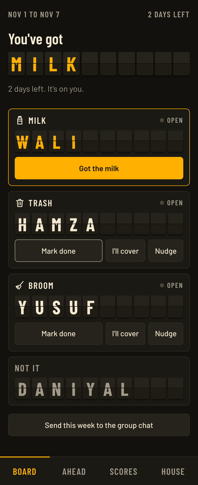

# Not It

A split-flap chore board for a shared house. Three chores, four roommates, one automatic weekly rotation. Whoever's off that week is, officially, **not it**.



## What it does

- **Rotates itself.** Each Sunday at 12:00 a.m. (Toronto time) milk, trash and broom move one seat along. Everyone does every chore once and gets one week off in every 4-week cycle.
- **Check-offs everyone can see.** Tick a chore and it flips on the board, with who ticked it and when. Phones sync on a 20-second poll and whenever the app is reopened.
- **Covers.** Away for a week? Someone taps "I'll cover". It only changes that week, and they get the credit.
- **Receipts.** A leaderboard of done, missed, late and covered chores, plus week-by-week history. Unfinished chores count as missed when the week ends, unless someone marks them done late during the following week.
- **Nudges.** Sends a message through the phone's share sheet, so reminders land in the group chat you already use.
- **No accounts.** One house code, then tap your name. Installs to the home screen as a PWA.

## How it's built

| Layer | Choice | Why |
| --- | --- | --- |
| Front end | React, TypeScript, Vite | Mobile-first PWA with a hand-built CSS split-flap animation |
| API | Hono on Cloudflare Workers | Same origin as the app, no cold starts |
| Database | Cloudflare D1 (SQLite) | Real SQL on the free tier |
| Tests | Vitest, Playwright | Rules and API tests, plus a browser run against the real runtime |

```
shared/domain.ts    Rotation, week math, scoring: pure functions shared by both sides
worker/app.ts       API routes and the logic that writes out each week
worker/auth.ts      PBKDF2 code hashing and HMAC-signed sessions, using only WebCrypto
migrations/         D1 schema
src/                React app; components/SplitFlap.tsx is the board
test/               API tests run real SQL on an in-memory SQLite stand-in for D1
e2e/                Multi-user browser flow
```

### Design decisions

**The rotation needs no cron job.** A week's assignment is a formula: `roster[(weekIndex + choreIndex) % size]`. Any request writes out the weeks since the last one on record, so weeks nobody opened still exist and still count as missed. `INSERT OR IGNORE` on the `(week_start, chore)` key makes simultaneous requests harmless.

**Dates are plain strings.** Weeks are `YYYY-MM-DD` values worked out in `America/Toronto`, so daylight saving can't shift a week, and the rollover happens at Toronto midnight rather than UTC midnight.

**History is written once.** Each row stores both who was scheduled and who ended up responsible. Renaming someone or covering a chore never rewrites the record or the future rotation. Weeks older than last week can't be edited.

**Auth fits a four-person house, without being careless.** The code is salted and hashed with PBKDF2. Sessions are signed `HttpOnly`, `SameSite=Strict` cookies. Five wrong codes locks that IP out for 15 minutes. The invite link keeps the code in the URL fragment, which is never sent to a server, and removes it from the address bar on arrival. Roommates are trusted not to tap each other's names.

## Running it

```bash
npm install
npm run start     # builds, migrates a local D1, serves on http://localhost:8787
npm test          # rules and API tests
npm run test:e2e  # browser flow; needs an empty local database and the server running
```

## Deploying your own

```bash
npx wrangler login
npx wrangler d1 create not-it     # paste the database_id into wrangler.jsonc
npm run deploy
```

Then open the URL and set up the board straight away. The first person to do so claims it.

## Not built yet

- Push notifications. Nudges go through the group chat for now.
- Changing the roster or house code from inside the app.
